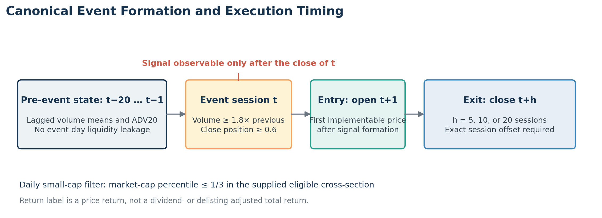
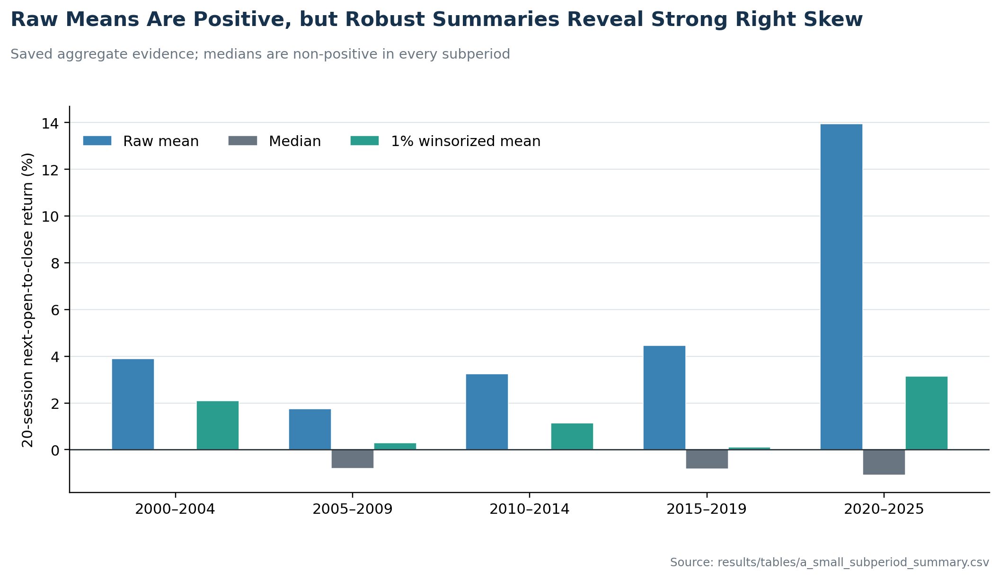
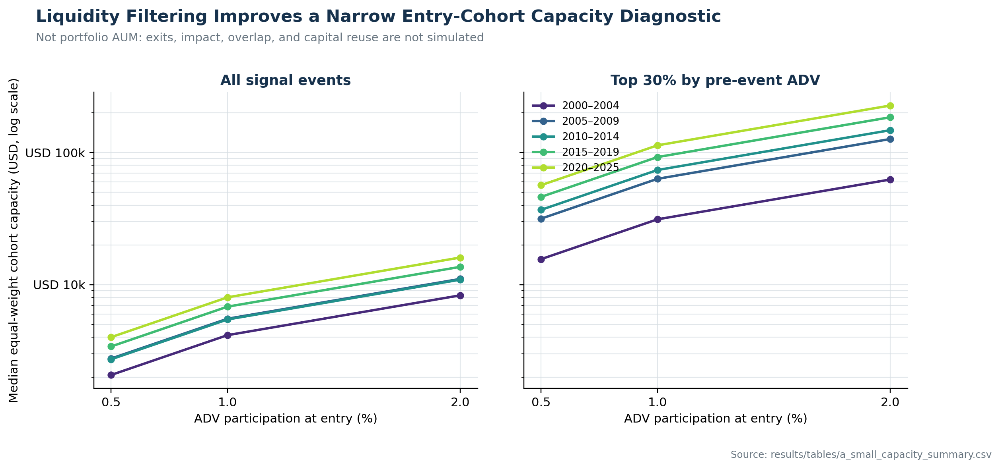

# Small-Cap Volume Regime-Shift Event Alpha

**CRSP, 2000–2025 · Dongjun Miao**

This repository documents an empirical event study of U.S. small-cap stocks that move from unusually dormant volume into a high-volume, strong-close session. It asks whether the event is followed by positive price drift, whether the finding is broad or tail-driven, and whether the signal is plausibly implementable after delayed entry, simple cost stresses, and liquidity constraints.

This is a research artifact, not a production strategy or investment recommendation. No CRSP/WRDS security-level data, event extracts, credentials, or original Git history are distributed.

## Research question and event timing

For security `i` on market session `t`, the canonical event is

```text
volume[t-1] < mean(volume[t-5:t-1])
volume[t-1] < 0.8 × mean(volume[t-20:t-1])
volume[t]   ≥ 1.8 × volume[t-1]
close_position[t] ≥ 0.6
daily market-cap percentile[t] ≤ 1/3
```

where `close_position = (close-low)/(high-low+ε)`. Lagged volume baselines and pre-event ADV use information through `t-1`. The event becomes observable only after the close of `t`; the return label enters at the open of `t+1` and exits at the close of `t+h`, for `h ∈ {5, 10, 20}`. Exact market-session offsets are required.



## Verified saved results

The canonical saved tables contain **929,294 events** and **787,359 valid 20-session labels**. These counts and statistics were verified directly from the committed aggregate CSVs. The licensed inputs and security-level event samples needed to independently recompute them were not present at packaging time; therefore the repository distinguishes artifact verification from full raw-data reproduction.

| Subperiod | Events | Valid 20d | Mean 20d | Median 20d | 1% winsorized mean | Mean − 100 bp |
|---|---:|---:|---:|---:|---:|---:|
| 2000–2004 | 249,220 | 195,457 | 3.90% | 0.00% | 2.09% | 2.90% |
| 2005–2009 | 208,194 | 174,470 | 1.74% | −0.79% | 0.29% | 0.74% |
| 2010–2014 | 165,976 | 144,063 | 3.25% | −0.01% | 1.15% | 2.25% |
| 2015–2019 | 138,272 | 123,453 | 4.46% | −0.83% | 0.10% | 3.46% |
| 2020–2025 | 167,632 | 149,916 | 13.94% | −1.08% | 3.14% | 12.94% |

The raw mean is positive in every subperiod, but the median is never positive and hit rates are below 50%. The large mean/median and mean/winsorized gaps show that the result is strongly right-skewed rather than broadly distributed. In the pooled small-cap sample, the lower half of the daily small-cap tercile has a 20-day mean of 8.42%, a median of −1.06%, and a 1% winsorized mean of 2.00%; the upper half has 2.05%, −0.14%, and 0.43%, respectively. Post-2020, the corresponding microcap-small figures are 22.55%, −2.87%, and 9.99%.



These are event-level price returns, not portfolio returns. The 40 bp and 100 bp columns subtract a fixed amount from each event mean; they are sensitivity haircuts, not a spread/impact/turnover model.

## Liquidity and capacity

Capacity is reported as a conservative equal-weight **entry-cohort** diagnostic:

```text
cohort capacity = event count on date × min(participation × ADV20_pre)
```

At 1% ADV participation, median cohort capacity for all events ranges from about **$4.2k to $8.0k** across subperiods. Retaining only events at or above the subperiod's 70th ADV percentile raises the range to about **$31k to $113k**, while reducing median events per signal date. This is not an estimate of deployable portfolio AUM because overlapping holdings, exits, impact, partial fills, and capital reuse are not simulated.



## What the evidence does and does not support

Supported by the saved artifacts:

- positive raw mean next-open-to-close 20-session returns in all five subperiods;
- non-positive medians, sub-50% hit rates, and large sensitivity to 1% winsorization;
- concentration of the raw mean in the microcap-small segment, especially after 2020;
- severe entry-cohort capacity constraints under the stated ADV participation rule.

Not established:

- statistical significance after dependence from overlapping events;
- dividend- and delisting-adjusted total returns;
- survivorship-free universe construction beyond the private input contract;
- realistic net portfolio performance or institutional capacity;
- live or out-of-sample trading performance.

## Repository map

```text
configs/                 documented event and input contracts
docs/                    audit, evidence ledger, licensing, release checklist
examples/                synthetic, non-CRSP smoke test
figures/                 figures generated only from code/method and saved aggregates
notebooks/               canonical v2 notebooks (no embedded outputs)
results/tables/          aggregate saved results only
scripts/                 full pipeline and public-figure builder
src/event_alpha/         canonical event, label, and reporting implementation
tests/                   contract and saved-artifact integrity tests
```

The v2 notebooks are thin interfaces to `src/event_alpha`; legacy v1 notebooks are deliberately excluded because their size bucketing, rolling windows, and return labels were inconsistent. See [the migration note](docs/legacy_migration.md).

## Reproduction

### Public verification (no CRSP data required)

```bash
python -m venv .venv
python -m pip install -r requirements.txt
python -m pip install -e .
python -m unittest discover -s tests -v
python examples/synthetic_smoke_test.py
python scripts/build_public_figures.py
```

### Licensed full-data run

Provide a private directory containing files named `2000-2004_research_v1.csv` through `2020-2025_research_v1.csv`, then run:

```bash
python scripts/run_research.py --data-dir "<PRIVATE_DATA_DIR>" --output-dir "output/tables"
```

The command writes security-level event samples under `output/`; that directory is ignored and must not be committed. Input expectations and known boundary effects are documented in [the methodology](docs/canonical_methodology.md) and [data contract](configs/data_contract.yaml).

## Evidence and release status

- [Empirical integrity audit](docs/empirical_integrity_audit.md)
- [Results evidence ledger](docs/results_evidence.md)
- [Source inventory and provenance](docs/source_inventory.md)
- [CRSP/WRDS data licensing note](docs/data_license.md)
- [Public release checklist](docs/public_release_checklist.md)
- [Concise CV description](docs/cv_description.md)

The package is a **CONDITIONAL GO** for public release: the code, aggregate evidence, and disclosures are public-safe, but the author should choose a repository license and, if raw reproducibility is claimed, rerun the canonical pipeline inside the licensed environment and compare the regenerated tables with the recorded hashes.

## Author

Dongjun Miao · target repository: `dongjun-miao/small-cap-event-alpha`
